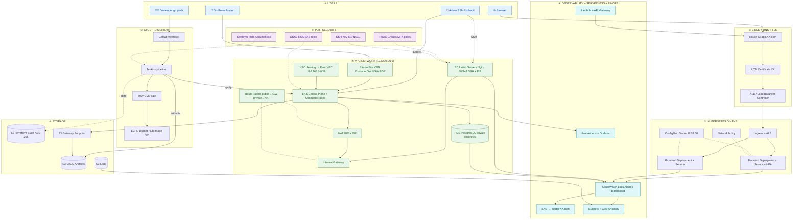
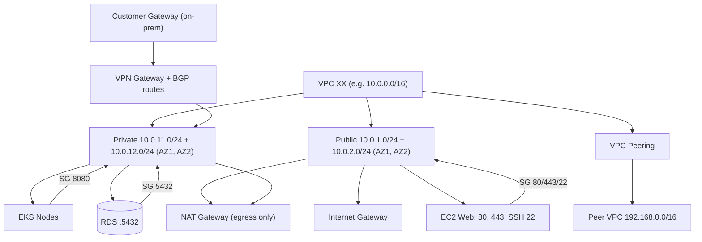

# CloudOps Sentinel — Complete AWS Architecture

> Full architecture of the infrastructure built in
> `infrastructure/terraform/aws-complete/`, `infrastructure/cloudformation/`
> and hosted on EKS via `kubernetes/eks/`.
> Every key value is `XX` — replace before applying.

**Rendered diagram:** [`docs/architecture-complete.png`](architecture-complete.png)
**Mermaid source:** [`docs/architecture-complete.mmd`](architecture-complete.mmd)
*(Export/regenerate: `npx -y @mermaid-js/mermaid-cli@11 -i docs/architecture-complete.mmd -o docs/architecture-complete.png -w 2200 -b white`)*

---

## Complete architecture diagram

---

## Layer-by-layer explanation

| # | Layer | What happens |
|---|---|---|
| ① | **Users** | Browser (HTTPS), admin (SSH + kubectl), on-prem router (VPN), developer (git push) |
| ② | **Edge / DNS / TLS** | Route 53 → ACM certificate → ALB (AWS Load Balancer Controller) |
| ③ | **CI/CD DevSecOps** | GitHub webhook → Jenkins → Trivy CVE gate → ECR/Docker Hub image |
| ④ | **VPC network** | Public subnets (IGW, NAT, EC2 Nginx web servers + EIP); private subnets (EKS nodes + RDS); route tables, Site-to-Site VPN, VPC Peering |
| ⑤ | **Kubernetes on EKS** | Ingress → backend/frontend Deployments + Services + HPA; ConfigMap/Secret, IRSA ServiceAccount, NetworkPolicy |
| ⑥ | **IAM / Security** | RBAC groups + Virtual MFA policy, Deployer Role (AssumeRole), OIDC/IRSA, SSH key pair, Security Groups + NACL |
| ⑦ | **Storage** | S3 state / artifacts / logs (versioned, AES-256, lifecycle), S3 gateway endpoint |
| ⑧ | **Observability / Serverless / FinOps** | CloudWatch + SNS alerts, Prometheus/Grafana, Lambda + API Gateway, Budgets + Cost Anomaly |

## Network topology detail

## Resource-to-file map

| Layer | Terraform | CloudFormation | Kubernetes |
|---|---|---|---|
| VPC / subnets / NAT / routes | `network.tf` | `complete-stack.yaml` | — |
| Site-to-Site VPN | `network.tf` | `complete-stack.yaml` | — |
| VPC Peering | `peering.tf` | `complete-stack.yaml` | — |
| Security groups / NACL | `security.tf` | `complete-stack.yaml` | `networkpolicy.yaml` |
| IAM / RBAC / MFA / IRSA | `iam.tf` | `complete-stack.yaml` | `serviceaccount.yaml` |
| EC2 Nginx web server | `ec2.tf` | `complete-stack.yaml` | — |
| S3 (state/artifacts/logs) | `s3.tf` | `complete-stack.yaml` | — |
| EKS control plane + nodes | `eks.tf` | `eks-cluster.yaml` | `deployment.yaml`, `service.yaml`, `ingress.yaml`, `hpa.yaml` |
| RDS PostgreSQL | `rds.tf` | — (add separately) | `configmap.yaml`, `secret.yaml` |
| Lambda + API Gateway | `lambda.tf` | `complete-stack.yaml` | — |
| Monitoring / alerts | `monitoring.tf` | `complete-stack.yaml` | `prometheus.yml`, Grafana JSON |
| Budgets / cost | `cost.tf` | `complete-stack.yaml` | — |

> Mermaid renders on GitHub and at https://mermaid.live. The PNG was exported with mermaid-cli.
