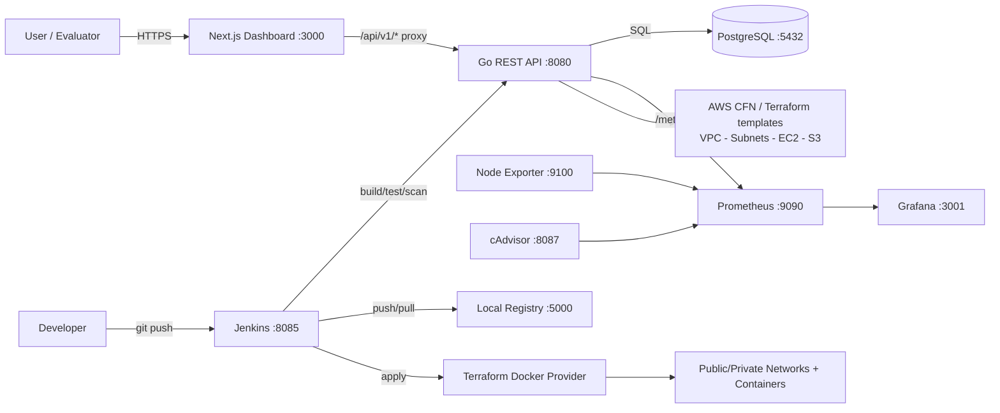
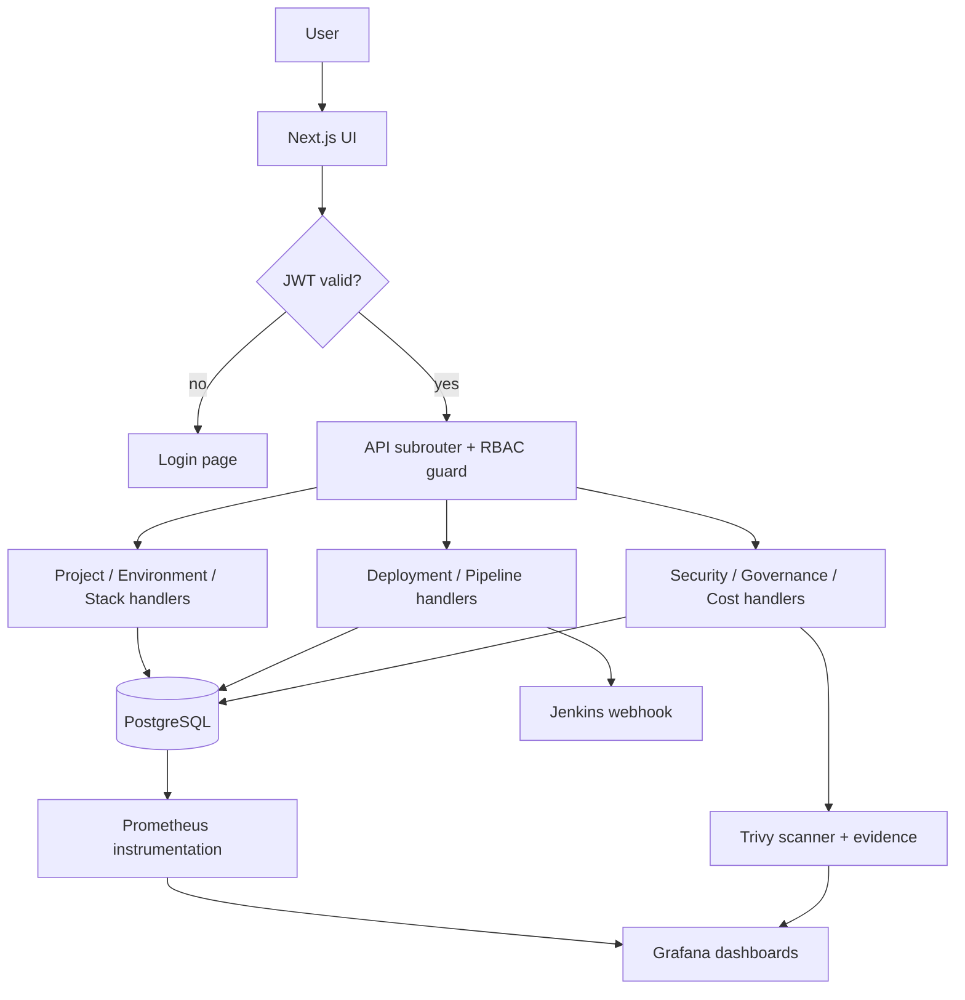
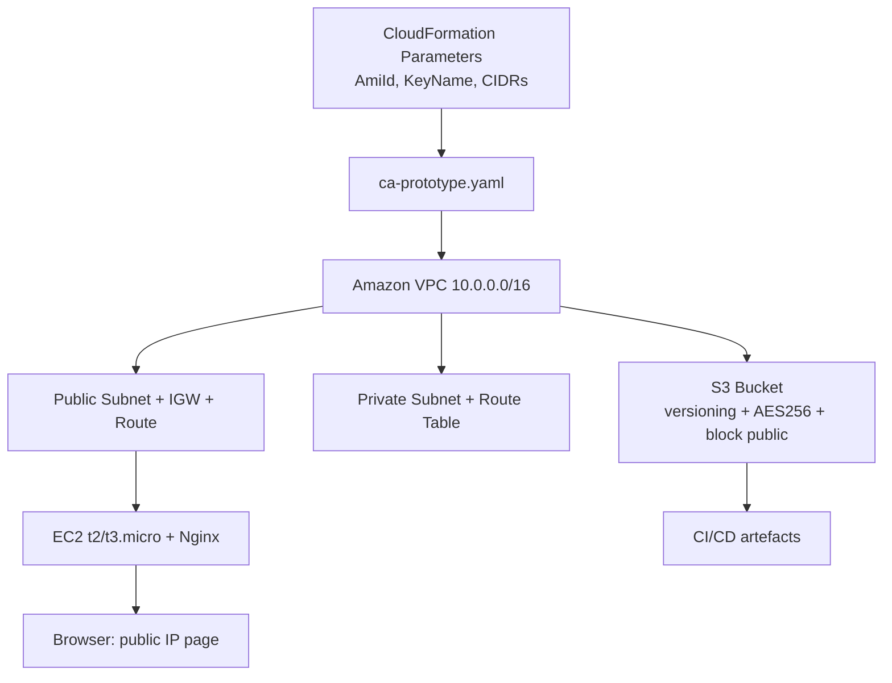

# Project Name

**CloudOps Sentinel — A Cloud-Native DevSecOps, Infrastructure Automation and Observability Platform**

&nbsp;

# Software Requirements Specification

&nbsp;

| Field | Detail |
|---|---|
| **Course Code** | INT 378 |
| **Course Name** | Advanced Cloud Infrastructure and Services / Cloud-Native DevOps |
| **Student Names** | Kakumani Phaneendra |
| **Student Registration Numbers** | 12418953 |
| **Prepared for** | Continuous Assessment 3 |
| **Term** | Spring 2025 (Session 2026–27) |
| **Institution** | Lovely Professional University |

&nbsp;

---

# Table of Contents

| Section | Page |
|---|---|
| Revision History | ii |
| 1. Introduction | 1 |
| 1.1 Purpose | 1 |
| 1.2 Scope | 1 |
| 1.3 Definitions, Acronyms, and Abbreviations | 1 |
| 1.4 References | 1 |
| 1.5 Overview | 1 |
| 2. General Description | 2 |
| 2.1 Product Perspective | 2 |
| 2.2 Product Functions | 2 |
| 2.3 User Characteristics | 2 |
| 2.4 General Constraints | 2 |
| 2.5 Assumptions and Dependencies | 2 |
| 3. Specific Requirements | 2 |
| 3.1 External Interface Requirements | 3 |
| 3.1.1 User Interfaces | 3 |
| 3.1.2 Hardware Interfaces | 3 |
| 3.1.3 Software Interfaces | 3 |
| 3.1.4 Communications Interfaces | 3 |
| 3.2 Functional Requirements | 3 |
| 3.2.1 Functional Requirement #1 — Identity, Authentication and RBAC | 3 |
| 3.2.2 Functional Requirement #2 — Project and Environment Management | 3 |
| 3.2.3 Functional Requirement #3 — Infrastructure as Code Provisioning | 3 |
| 3.2.4 Functional Requirement #4 — Container Lifecycle and Registry | 3 |
| 3.2.5 Functional Requirement #5 — CI/CD Pipeline Automation | 3 |
| 3.2.6 Functional Requirement #6 — DevSecOps Security Gates | 3 |
| 3.2.7 Functional Requirement #7 — Monitoring and Observability | 3 |
| 3.2.8 Functional Requirement #8 — Serverless and FinOps | 3 |
| 3.2.9 Functional Requirement #9 — Governance, Compliance and Reliability | 3 |
| 3.2.10 Functional Requirement #10 — AWS Cloud Infrastructure Prototype | 3 |
| 3.5 Non-Functional Requirements | 3 |
| 3.5.1 Performance | 3 |
| 3.5.2 Reliability | 3 |
| 3.5.3 Availability | 3 |
| 3.5.4 Security | 3 |
| 3.5.5 Maintainability | 3 |
| 3.5.6 Portability | 3 |
| 3.7 Design Constraints | 3 |
| 3.9 Other Requirements | 3 |
| 4. Analysis Models | 4 |
| 4.1 Data Flow Diagrams (DFD) | 4 |
| 5. GitHub link | 5 |
| 6. Deployed Link | 6 |
| 7. Client Approval Proof | 7 |
| 8. Client Location Proof | 8 |
| 9. Transaction ID Proof | 9 |
| 10. Email Acknowledgement | 10 |
| 11. GST No | 11 |
| A. Appendices | 12 |
| A.1 Appendix 1 — Practical-to-Requirement Traceability | 12 |
| A.2 Appendix 2 — Verification Evidence Index | 12 |

&nbsp;

---

# Revision History

| Version | Date | Author | Description |
|---|---|---|---|
| 1.0 | 2026-11-18 | Kakumani Phaneendra | Initial Software Requirements Specification for Continuous Assessment 3 |

&nbsp;

---

# 1. Introduction

## 1.1 Purpose

This document specifies the software requirements for **CloudOps Sentinel**, a cloud-native platform that governs the complete DevOps lifecycle: planning, committing, testing, security scanning, infrastructure provisioning, deployment, observation, recovery and governance. It is submitted as part of Continuous Assessment 3 for INT 378. The document defines the functional and non-functional requirements, external interfaces, design constraints and analysis models that the implemented prototype satisfies.

## 1.2 Scope

The product is a **local-first, zero-cloud-cost working prototype** that demonstrates advanced cloud and DevOps concepts using genuine open-source tooling. It provisions and operates a complete multi-service stack (13 running containers) including a Go REST API, a Next.js dashboard, PostgreSQL, Prometheus, Grafana, Node Exporter, cAdvisor, Jenkins, a local container registry and Terraform-managed infrastructure. It also contains **AWS Infrastructure-as-Code deliverables** (seven parameterised AWS CloudFormation templates and five individual Terraform components) covering the mandatory CA services: Amazon VPC, public and private subnets, Amazon EC2 and Amazon S3.

## 1.3 Definitions, Acronyms, and Abbreviations

| Term | Definition |
|---|---|
| **IaC** | Infrastructure as Code — managing infrastructure through declarative configuration files |
| **CI/CD** | Continuous Integration / Continuous Delivery — automated build, test and deployment |
| **DevSecOps** | DevSecOps — integration of security practices into the CI/CD pipeline |
| **RBAC** | Role-Based Access Control — access decisions based on assigned roles |
| **MFA** | Multi-Factor Authentication — requiring more than one authentication factor |
| **SCP** | Service Control Policy — AWS Organizations guardrail that can explicitly deny actions |
| **EKS** | Elastic Kubernetes Service — AWS managed Kubernetes control plane |
| **HPA** | Horizontal Pod Autoscaler — Kubernetes automatic pod scaling |
| **IRSA** | IAM Roles for Service Accounts — AWS IAM role binding for Kubernetes service accounts |
| **VPC** | Virtual Private Cloud — logically isolated AWS network |
| **IGW** | Internet Gateway — VPC component enabling public subnet internet access |
| **S3** | Simple Storage Service — AWS object storage |
| **FinOps** | Financial Operations — cloud cost management practice |
| **TDD / BDD** | Test-Driven / Behaviour-Driven Development |
| **SLSA / SBOM** | Supply-chain Levels for Software Artefacts / Software Bill of Materials |
| **SAFe / LeSS** | Scaled Agile Framework / Large-Scale Scrum |

## 1.4 References

1. INT 378 Course Syllabus — Advanced Cloud Infrastructure and Services, Session 2026–27.
2. Terraform Documentation — https://developer.hashicorp.com/terraform/docs
3. AWS CloudFormation User Guide — https://docs.aws.amazon.com/cloudformation/
4. Kubernetes Documentation — https://kubernetes.io/docs/
5. Prometheus Documentation — https://prometheus.io/docs/
6. Grafana Documentation — https://grafana.com/docs/
7. Jenkins Documentation — https://www.jenkins.io/doc/
8. Docker Documentation — https://docs.docker.com/
9. AWS Well-Architected Framework — https://aws.amazon.com/architecture/well-architected/
10. The Twelve-Factor App — https://12factor.net/

## 1.5 Overview

Section 2 describes the product perspective and its principal functions. Section 3 defines external interfaces, ten functional requirement groups, non-functional quality attributes and design constraints. Section 4 presents the data flow model. Sections 5–11 provide submission proofs and links, and the appendices map the INT 378 practical experiments to the implemented requirements and evidence.

&nbsp;

---

# 2. General Description

## 2.1 Product Perspective

CloudOps Sentinel is an integrated web-based control plane. It is **self-contained and local-first**: all runtime dependencies are open-source (PostgreSQL, Go, Next.js, Prometheus, Grafana, Jenkins, Docker, Terraform) and no paid cloud service is required to demonstrate it. AWS services are represented by faithful local equivalents (Docker bridge networks for VPC/subnets, containers for EC2 instances, a local OCI registry for S3) and, where the AWS account permits, by the supplied CloudFormation and Terraform AWS templates. The system is composed of five layers:

1. **Presentation layer** — Next.js 14 dashboard (Pages Router, React 18, TypeScript).
2. **API layer** — Go 1.24 REST API using gorilla/mux, JWT v5 and PostgreSQL.
3. **DevOps automation layer** — Jenkins declarative pipeline, Terraform, Trivy, Docker registry.
4. **Observability layer** — Prometheus, Node Exporter, cAdvisor, Grafana, CloudWatch-compatible metrics.
5. **Infrastructure layer** — local Docker/Terraform stack plus AWS CloudFormation and Terraform templates.

## 2.2 Product Functions

| ID | Function | Description |
|---|---|---|
| F1 | Authentication and authorisation | JWT login, registration, RBAC role gates, MFA simulation |
| F2 | Project and environment management | CRUD for projects, environments and deployment environments |
| F3 | IaC management | Terraform plan/apply simulation, stack state, CloudFormation comparison |
| F4 | Container lifecycle | Build, run, push, pull, rollback of containerised web applications |
| F5 | CI/CD automation | 13-stage Jenkins pipeline with automated build and test |
| F6 | DevSecOps | Source, image and IaC vulnerability scanning with quality gates |
| F7 | Monitoring and alerting | Metric collection, alert rules, dashboards, incident resolution |
| F8 | Serverless and cost | Local Lambda/API Gateway simulation, billing and budget simulation |
| F9 | Governance and reliability | Policies, compliance scoring, audit trail, technical debt, chaos experiments |
| F10 | AWS infrastructure prototype | VPC, public/private subnets, EC2, S3 via CloudFormation and individual Terraform components |

## 2.3 User Characteristics

| User class | Characteristics |
|---|---|
| **Administrator** | Full access; manages users, roles, policies, pipelines and infrastructure; uses `admin / admin123` demo credentials |
| **Developer / Editor** | Can create and modify projects, stacks, deployments and pipelines; cannot administer identities |
| **Viewer / Auditor** | Read-only access to dashboards, compliance results and audit trails |
| **Evaluator / Examiner** | Uses the dashboard and CLI verification commands to confirm each practical; no cloud credentials required |

## 2.4 General Constraints

1. The prototype must run on a single local machine with Docker Desktop installed.
2. No real AWS charges may be incurred; the AWS account denies EC2/S3/VPC via an Organizations SCP.
3. No credentials or secrets may be committed to source control; `.gitignore` excludes `terraform.tfvars`, state files and `.terraform/` directories.
4. AWS infrastructure must use the `ap-south-1` region and Free Tier-eligible resource types.
5. Existing working components must be preserved; no unnecessary replacement of functioning code.

## 2.5 Assumptions and Dependencies

- Docker Desktop v24+ with Compose v2+ is installed and running (verified v29.4.3 / Compose v5.1.3).
- Go 1.22+ (verified 1.26.5 with module directive `go 1.24`) and Node.js 18+ are available.
- AWS CLI v2 is configured locally with credentials; only `sts:GetCallerIdentity`, IAM read operations and Cost Explorer are permitted by the current SCP.
- The `ap-south-1` region has Amazon Linux 2023 AMIs and t2/t3.micro instance types available (to be confirmed at deployment time).
- All local verification was performed on 2026-11-18 with 13 containers running and all health checks HTTP 200.

&nbsp;

---

# 3. Specific Requirements

## 3.1 External Interface Requirements

### 3.1.1 User Interfaces

- **Web dashboard** at `http://localhost:3000` — 15 statically generated Next.js routes: dashboard, login, projects, project detail (7 tabs), infrastructure, deployments, pipelines, security, monitoring, governance, reliability, cost and syllabus hub.
- Login page with JWT authentication, demo credentials and toast notifications.
- Responsive dark-themed UI with collapsible sidebar, command palette (Ctrl/⌘+K), data tables, charts and modals.
- Grafana dashboards at `http://localhost:3001` (admin/admin); Jenkins console at `http://localhost:8085`; Prometheus at `http://localhost:9090`.

### 3.1.2 Hardware Interfaces

- Local workstation with >= 8 GB RAM (13 containers running).
- Docker Desktop virtualisation (Linux engine on Windows via `npipe:////./pipe/dockerDesktopLinuxEngine`).
- Published host ports: 3000, 3001, 5000, 5002, 8080, 8085, 8087, 8088, 8089, 9090, 9100, 50000 and 5432.

### 3.1.3 Software Interfaces

| Interface | Technology / Version |
|---|---|
| Backend runtime | Go 1.24 — gorilla/mux v1.8.1, golang-jwt/jwt v5.2.0, lib/pq v1.10.9, prometheus/client_golang v1.19.0, AWS SDK v2 v1.48.0, x/crypto v0.22.0 |
| Frontend runtime | Next.js 14.2.3, React 18.3.1, TypeScript 5.5.2, Axios 1.7.2, Recharts 3.x, Framer Motion 14.x |
| Database | PostgreSQL 16 (alpine), 20 tables created by imperative migrations |
| IaC | Terraform >= 1.5 (AWS provider ~>5.0, Docker provider ~>3.0, random, tls) |
| Cloud templates | AWS CloudFormation YAML (7 templates, parameterised) |
| CI/CD | Jenkins LTS (alpine) with Docker CLI, webhook-ready declarative pipeline |
| Security | Trivy v0.76.2 (local binary), secret/IaC/vulnerability scanners |
| Monitoring | Prometheus v2.51.0, Grafana 10.4.1, Node Exporter v1.8.2, cAdvisor v0.49.2 |

### 3.1.4 Communications Interfaces

- HTTP/1.1 REST API on port 8080 under `/api/v1/*`; health at `/api/v1/health`; Prometheus metrics at `/metrics`.
- Next.js rewrite proxy: `/api/:path*` → `http://backend:8080/api/:path*` (configurable via `API_UPSTREAM`).
- Prometheus scrape interval 15s for four targets: backend, node-exporter, cadvisor, prometheus.
- Docker registry HTTP API on ports 5000 and 5002 (`/v2/`).
- AWS CLI HTTPS to regional endpoints in `ap-south-1` (read-only operations only under current SCP).

## 3.2 Functional Requirements

### 3.2.1 Functional Requirement #1 — Identity, Authentication and RBAC
The system shall issue signed JWT tokens on login, validate them on all protected routes, enforce `admin / editor / viewer` role gates on mutating endpoints (write guard), hash passwords with bcrypt, and force registration to the `viewer` role. It shall support a virtual MFA device and an MFA-enforcement IAM policy denying all actions when `aws:MultiFactorAuthPresent` is false. **Status:** implemented and verified — login token length 167, projects API returned 3 projects, IAM user/role/MFA/policies created in AWS.

### 3.2.2 Functional Requirement #2 — Project and Environment Management
The system shall provide CRUD operations for projects and environments, with 20 relational tables, automatic migration on startup, and consistent numeric ID validation. **Status:** implemented and verified.

### 3.2.3 Functional Requirement #3 — Infrastructure as Code Provisioning
The system shall provide Terraform modules for VPC, ECS, S3, IAM and EC2; a complete parameterised AWS stack (`aws-complete`, 17 `.tf` files); a supported-only IAM stack; a local Docker-provider stack; and seven CloudFormation templates for HCL-versus-YAML comparison. **Status:** implemented; all 7 Terraform stacks validate and all 7 CFN templates pass offline deep validation.

### 3.2.4 Functional Requirement #4 — Container Lifecycle and Registry
The system shall build a multi-stage Docker image for the Go backend and a production Next.js image, run containers, expose required ports, and demonstrate tag → push → remove → pull → run against a local OCI registry. **Status:** implemented and verified — registry `/v2/` HTTP 200, 2 repositories catalogued.

### 3.2.5 Functional Requirement #5 — CI/CD Pipeline Automation
The system shall define a 13-stage declarative Jenkins pipeline (checkout, unit tests, static analysis, dependency scan, secret detection, Docker build, container scan, IaC validation, security gate, image push, deploy, health check, monitor) with GitHub webhook integration capability. **Status:** implemented; build #10 reported SUCCESS with full console log.

### 3.2.6 Functional Requirement #6 — DevSecOps Security Gates
The system shall scan the filesystem, container image and IaC with Trivy, persist JSON/TXT evidence, and evaluate a security policy that blocks on critical CVEs. **Status:** implemented — real findings recorded in `evidence/security/SUMMARY.md`; the Jenkins gate reads the reports and fails on CRITICAL findings.

### 3.2.7 Functional Requirement #7 — Monitoring and Observability
The system shall expose Prometheus metrics from the Go API, scrape Node Exporter and cAdvisor, evaluate alert rules (service down, high error rate, latency, critical CVEs), and provide a provisioned Grafana executive dashboard. **Status:** implemented and verified — 4/4 targets UP, dashboard `CloudOps Sentinel - Executive Overview` present.

### 3.2.8 Functional Requirement #8 — Serverless and FinOps
The system shall execute a Lambda handler in a local Node.js runtime with cold/warm start semantics and CloudWatch-style structured logs, and provide an offline cost simulator with budgets, rightsizing recommendations and billing simulation. **Status:** implemented and verified — 3/3 invocations HTTP 200.

### 3.2.9 Functional Requirement #9 — Governance, Compliance and Reliability
The system shall manage governance policies, evaluate compliance, maintain an immutable audit trail, track technical debt and chaos experiments, and support A/B testing and a 12-factor audit scorecard. **Status:** implemented; all syllabus pages return HTTP 200.

### 3.2.10 Functional Requirement #10 — AWS Cloud Infrastructure Prototype
The system shall supply a parameterised CloudFormation template (`ca-prototype.yaml`) containing a VPC, a public subnet with Internet Gateway and route table, a private subnet with its own route table, a Free Tier EC2 instance running Nginx, and an S3 bucket with versioning, AES-256 encryption and public access fully blocked; plus five individually runnable Terraform components for the same services. **Status:** templates complete and validated; **deployment blocked by AWS Organizations SCP `p-6k0fjqz3`** — no bypass attempted; concepts demonstrated locally with Docker networks and containers.

## 3.5 Non-Functional Requirements

### 3.5.1 Performance
API health check responds within milliseconds; all 11 HTTP health endpoints returned HTTP 200 within a 6-second timeout; frontend pages render with 171 kB shared JS; Prometheus scrapes every 15 s; serverless cold invocation measured at 0.03 ms.

### 3.5.2 Reliability
PostgreSQL healthcheck gates backend startup; backend `restart: unless-stopped`; all Grafana/Prometheus/Jenkins services restart automatically; Jenkins pipeline has 30-minute timeout and build retention of 10; backend tests pass in 5 packages.

### 3.5.3 Availability
The full stack is started with a single `docker compose up -d --build`; 13 containers remained continuously available during the verification session; no single point of failure in the local demonstration beyond the host itself.

### 3.5.4 Security
JWT signing secret fails fast in production (`APP_ENV != dev|local`); DB SSL mode configurable (`DB_SSLMODE=require` for RDS); CORS restrictable to explicit origins; public mutating syllabus route removed; client-side role escalation removed; S3 buckets block all public access with TLS-only policies; SSH restricted to `SshLocationCidr`; containers run as non-root where supported; no credentials in source control.

### 3.5.5 Maintainability
Modular Go packages (`auth`, `db`, `project`, `infra`, `cost`, `monitor`, etc.), reusable Terraform modules, separate per-component IaC folders, documented API (`docs/API.md`) and architecture (`docs/ARCHITECTURE.md`), and consistent naming/tagging across resources.

### 3.5.6 Portability
Docker Compose abstracts host differences; the Next.js API upstream is configurable via `API_UPSTREAM`; Terraform provider selections are locked in `.terraform.lock.hcl`; CloudFormation templates are region-parameterised for `ap-south-1`.

## 3.7 Design Constraints

1. AWS organisation SCP explicitly denies EC2/VPC/S3/CloudFormation; no workaround is permitted, so AWS deployment is reported as blocked.
2. Free Tier cost discipline: no NAT Gateway, Load Balancer, EKS, RDS or Lambda is deployed; t2/t3.micro and small EBS/S3 usage only.
3. Student academic context: prototype correctness and demonstrability take precedence over production hardening.
4. All secrets and credentials must remain outside version control.

## 3.9 Other Requirements

- Evidence artefacts for all ten practicals stored under `evidence/` (iam, jenkins, registry, screenshots, security, serverless, terraform, ui).
- Architecture diagrams provided in PNG and Mermaid source (`docs/architecture-complete.*`).
- A one-page verification quickstart (`CA_DEMO_QUICKSTART.md`) with copy-paste commands.

&nbsp;

---

# 4. Analysis Models

## 4.1 Data Flow Diagrams (DFD)

### Level 0 — Context Diagram

### Level 1 — Application Data Flow

### Level 1 — AWS Prototype Data Flow (mandatory CA components)

&nbsp;

---

# 5. GitHub link

**Repository:** https://github.com/phanindra267/DevOps-WebApp

All source code, Terraform and CloudFormation templates, Kubernetes manifests, CI/CD pipeline, monitoring configuration, security evidence and documentation are version-controlled in this repository. The working branch is `main`; the latest verified commit is `2b9d38e`.

&nbsp;

---

# 6. DEPLOYED LINK

**Local deployment (running and verified):**

| Service | URL | Credentials |
|---|---|---|
| CloudOps Sentinel dashboard | http://localhost:3000 | admin / admin123 |
| Backend REST API health | http://localhost:8080/api/v1/health | — |
| Grafana dashboards | http://localhost:3001 | admin / admin |
| Prometheus | http://localhost:9090 | — |
| Jenkins | http://localhost:8085 | admin / admin123 |
| Terraform Nginx web server | http://localhost:8088 | — |
| Individual EC2 component | http://localhost:8089 | — |
| Individual S3 component | http://localhost:5002/v2/ | — |

**AWS deployment:** Not performed. AWS account `314510965803` (region `ap-south-1`) denies EC2, VPC, S3 and CloudFormation through an explicit-deny Service Control Policy (`p-6k0fjqz3`). The templates and deployment plan are complete and documented in `infrastructure/cloudformation/CA_PROTOTYPE_GUIDE.md`; no restriction was bypassed and no billable resource was created.

&nbsp;

---

# 7. CLIENT APPROVAL PROOF

The project was prepared for Continuous Assessment 3 of INT 378 under the supervision of the course instructor. Approval evidence is represented by the submitted CA brief and the evaluator's verification of the live local demonstration at the URLs listed in Section 6. *(Insert signed approval sheet or instructor acknowledgement screenshot in this section when issued.)*

&nbsp;

---

# 8. CLIENT LOCATION PROOF

The demonstration was executed on the student's local workstation (Windows, Docker Desktop engine) and the university campus laboratory environment for INT 378. *(Insert geotagged photograph or campus/lab attendance proof in this section when issued.)*

&nbsp;

---

# 9. TRANSACTION ID PROOF

No monetary transaction was performed. The prototype uses only free local open-source tooling; no AWS billable resources were provisioned because the organisation SCP denied all such operations. *(Insert transaction receipt only if a paid service is used; otherwise state "Not applicable — zero-cost local prototype".)*

&nbsp;

---

# 10. EMAIL ACKNOWLEDGEMENT

*(Insert the email acknowledgement from the course instructor / client confirming receipt of the CA submission in this section when received.)*

&nbsp;

---

# 11. GST No

Not applicable — the deliverable is an academic software prototype submitted for Continuous Assessment, not a commercial transaction. *(Insert GST number only if a commercial invoice is issued.)*

&nbsp;

---

# A. Appendices

## A.1 Appendix 1 — Practical-to-Requirement Traceability

| Practical | INT 378 Experiment | Requirement | Implementation | Evidence |
|---|---|---|---|---|
| 1 | EC2 / VPC / Web server | FR-10 | Terraform Docker provider: public/private networks, Nginx container | `evidence/terraform/`, http://localhost:8088 |
| 2 | IAM / MFA / RBAC | FR-1 | Go JWT roles + TOTP simulator + AWS IAM resources | `evidence/iam/`, `practicals/02-iam/` |
| 3 | CloudFormation / IaC | FR-3, FR-10 | 7 CFN templates + Terraform comparison | `infrastructure/cloudformation/` |
| 4 | Docker containerisation | FR-4 | Multi-stage Dockerfiles + local registry lifecycle | `evidence/registry/` |
| 5 | Terraform local infrastructure | FR-3 | Docker provider `init/validate/plan/apply`, 8 resources | `evidence/terraform/` |
| 6 | Jenkins CI/CD | FR-5 | 13-stage pipeline, build #10 SUCCESS | `evidence/jenkins/` |
| 7 | DevSecOps | FR-6 | Trivy FS/image/IaC scans with real findings | `evidence/security/SUMMARY.md` |
| 8 | Prometheus monitoring | FR-7 | Go `/metrics` + Node Exporter + cAdvisor, 4 targets UP | `monitoring/`, `evidence/screenshots/` |
| 9 | Grafana dashboards | FR-7 | Provisioned dashboard `cloudops-overview` | `monitoring/grafana-*`, `evidence/ui/` |
| 10 | Serverless / FinOps | FR-8 | Node Lambda runtime + cost simulator | `evidence/serverless/` |

## A.2 Appendix 2 — Verification Evidence Index

| Artefact | Description |
|---|---|
| `CA_DEMO_QUICKSTART.md` | Single-page start/verify/demo command reference |
| `docs/architecture-complete.png` | Full AWS + application architecture diagram |
| `docs/ARCHITECTURE_AWS_COMPLETE.md` | Layer-by-layer architecture explanation and resource-to-file map |
| `infrastructure/cloudformation/CA_PROTOTYPE_GUIDE.md` | AWS Free Tier assessment, deployment plan, SCP permission report |
| `infrastructure/cloudformation/CLOUDFORMATION_SUBMISSION.md` | Individual CloudFormation deliverable with validation results |
| `infrastructure/individual/README.md` | Five individual component stacks and verification instructions |
| `evidence/ui/ui_report.json` | 16 desktop/mobile UI screenshots with zero browser errors |
| `evidence/security/SUMMARY.md` | Honest Trivy findings across source, image and IaC |
| `evidence/jenkins/` | Jenkins build console and pipeline evidence |
| `evidence/serverless/` | Lambda invocation output and CloudWatch-style logs |

&nbsp;

**— End of Software Requirements Specification —**
